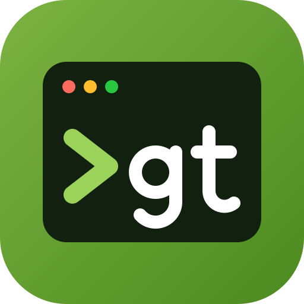

#  gitea-cli

The BakeLab CLI is maintained in this repository's `cli/` module. Download its
binaries and checksums from the [internal Gitea releases](https://gitea.int.bb.pub/BakeLab/gitea/releases).
See [integration notes](INTEGRATION.md) for source history and development.

[](https://opensource.org/licenses/MIT)
[](https://gitea.com/gitea/cli/releases)
[](https://discord.gg/Gitea)
[](https://godoc.org/gitea.dev/cli)


## The official CLI for Gitea

gitea-cli manages repositories, issues, pull requests, releases, and other Gitea resources
with explicit commands suitable for local development and CI. The binary is called `gt`.

```sh
gt auth login --host https://gitea.example.org --with-token < token-file
gt issue list --repo owner/repository
gt pr view 123 --repo owner/repository --json
gt alias set bugs 'issue list --label bug'
gt help
```

Scripts and agents get stable machine-readable output: `--json` and `--jq` select fields that gt only
ever adds to, and `gt schema` lists them with their types. `--template` formats the same JSON with a Go
template, as in `gh`.

With `GITEA_CLI_ERROR_FORMAT=json`, a failure is one line of JSON on stderr.

`--dry-run` previews the write requests of every command that only changes Gitea, such as `gt pr merge`, without sending them.

gt requires Gitea 28 or newer. It keeps its preferences in `config.yml` and its
instances and accounts in `hosts.yml`.
Run `gt --help` or `gt <command> --help` for supported commands and flags; the
full reference, man pages, and shell completions ship in each release's docs archive.
Credentials use the operating-system keyring by default; explicitly
select `--credential-store file` when private file storage is needed. For CI,
supply `GITEA_TOKEN` and its instance through `GITEA_CLI_HOST` or `GITEA_INSTANCE_URL`;
environment credentials are never persisted.

## Installation

Download the binary and its matching `.sha256` file from the latest completed
[internal Gitea release](https://gitea.int.bb.pub/BakeLab/gitea/releases).
Sign in with your internal account to access the assets.

| System | Binary |
| --- | --- |
| Linux x86-64 | `gt-linux-amd64` |
| Linux ARM64 | `gt-linux-arm64` |
| macOS Apple Silicon | `gt-darwin-arm64` |

For example, after downloading the Linux x86-64 binary and checksum:

```sh
sha256sum -c gt-linux-amd64.sha256
mkdir -p ~/.local/bin
install -m 755 gt-linux-amd64 ~/.local/bin/gt
~/.local/bin/gt --version
```

On macOS, verify with `shasum -a 256 -c gt-darwin-arm64.sha256` and install
`gt-darwin-arm64` instead. Ensure `~/.local/bin` is on your PATH. The release
manifest records the Gitea commit and the `cli/` source path for the binary.

After this installation, `gt upgrade` follows the internal Gitea release assets.
Earlier BakeLab `dev` binaries are detected as source builds and require this
one-time manual replacement. Source development builds remain available through
[Compilation](#compilation).

### Log in to Gitea from gt

Gitea can use many different authentication schemes, and not every authentication method will work with every Gitea deployment. When you are a Gitea instance administrator you can tweak your settings to fit your use case. For the method that is most likely to work with any Gitea deployment use the following steps:

1. Open your Gitea instance in a web browser

2. Log in to Gitea in your web browser. Any MFA, IDP, or whatever else should be available this way.

3. In your "user settings", generate an application token with at least **user read** permissions. If you want to do anything useful with the token add additional permissions/scopes.

4. Save the token in a private file and run `gt auth login --host https://your-instance --with-token < token-file`. Credentials use the operating-system keyring by default.

You should now be logged in to your gitea instance from gt.

Alternatively, `gt auth login --host https://your-instance --oauth` authorizes gt in your browser. OAuth may not be available on all Gitea deployments, and needs a browser on the machine running gt.

### Coming from tea

gt replaces tea. [Migrating from tea](docs/migrating-from-tea.md) maps tea's commands and flags
to gt's.

### Shell completion

If you installed from source or the package does not provide the completions with it you can add them yourself with `gt completion <shell>` command. Add the line for your shell to its startup file:

```shell
# ~/.bashrc (on macOS, ~/.bash_profile)
eval "$(gt completion bash)"

# ~/.zshrc, after compinit
autoload -U compinit && compinit
source <(gt completion zsh)

# fish
gt completion fish > ~/.config/fish/completions/gt.fish

# PowerShell profile
gt completion powershell | Out-String | Invoke-Expression
```

The bash script needs the bash-completion package. `gt completion <shell> --help` shows the details for each shell.

### Man Page

The hidden command `gt man` can be used to generate the `gt` man page.

```shell
# for bash or zsh
man <(gt man)

# for fish
man (gt man | psub)

# write man page to a file
gt man --output-file ./gt.man
```

### Agent skill

An [agent skill](https://agentskills.io) teaches coding agents to drive `gt`: checking CI and
reading the logs of failed jobs, turning an issue into a pull request, commenting and reviewing.
It replaces [gitea-tea-skill](https://gitea.com/gitea/gitea-tea-skill). Install it with
[skills](https://github.com/vercel-labs/skills):

```shell
# for the current project
npx skills add https://gitea.com/gitea/cli.git --skill gt

# for all your projects
npx skills add https://gitea.com/gitea/cli.git --skill gt -g

# after upgrading gt
npx skills update gt
```

## Compilation

Make sure you have a current Go version installed (1.27 or newer).

- To compile the source yourself with the recommended flags & tags:
  ```sh
  git clone --branch trim https://github.com/BakeLab/gitea.git
  cd gitea/cli
  make
  ```
  Note that GNU Make (gmake on OpenBSD) is required.
  If you want to install the compiled program you have to execute the following command:
  ```sh
  make install
  ```
  This installs the binary into the "bin" folder inside of your GOPATH folder (`go env GOPATH`). It is possible that this folder isn't in your PATH Environment Variable. 

- To install from an existing checkout without Make, run from `cli/`:
  ```sh
  go install ./cmd/gt
  ```

## Contributing

Fork -> Patch -> Push -> Pull Request

- `make test` run unit tests
- `make vet`  run checks (check the order of imports; preventing failure on CI pipeline beforehand)
- `make build` builds the production CLI
- `make docs` regenerates references, man pages, and shell completions in `docs/generated` (not committed; built on release)
- ... (for other development tasks, check the `Makefile`)

**Please** read the [CONTRIBUTING](CONTRIBUTING.md) documentation, it will tell you about internal structures and concepts.

## License

This project is under the MIT License. See the [LICENSE](LICENSE) file for the
full license text.
